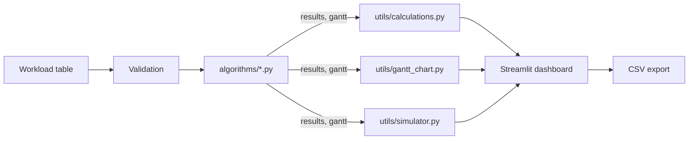

<div align="center">

# ⚡ CPU Scheduling Visualizer & Benchmark Suite

**An interactive simulation and benchmarking platform for Operating Systems CPU scheduling.**


[Features](#-key-features) •
[Algorithms](#-supported-algorithms) •
[Getting Started](#-getting-started) •
[Presets](#-demonstration-presets) •
[Metrics](#-telemetry--performance-metrics) •
[Structure](#-project-structure)

</div>

---

## 📖 About

Reading hand-drawn Gantt charts is slow, and comparing algorithms by hand is error-prone. This project lets you **edit a workload, run any scheduling algorithm (or all nine at once), watch the CPU dispatch clock-cycle by clock-cycle, and compare results** with standard OS performance metrics. Concepts like the *convoy effect*, *starvation* and *missed deadlines* become visible and measurable.

---

## 🌟 Key Features

| | Feature | Description |
|---|---|---|
| 🧠 | **9 Scheduling Algorithms** | From FCFS to real-time EDF and dual-core SMP, each as a separate reusable module |
| 📊 | **Multi-Core Gantt Timeline** | Horizontal bars with millisecond boundaries, per-process colours and one lane per core |
| ⏯️ | **Step-by-Step Scrubber** | Play / Next / Prev / Reset through *t = 0 … Makespan*, watching the CPU, RAM ready queue and process states evolve |
| 🏆 | **Compare All Algorithms** | Benchmark every algorithm on the same workload in one matrix with comparison charts |
| 🎯 | **Demo Presets** | Seven ready-made workloads that highlight classic scheduling behaviours |
| ✅ | **Input Validation** | Rejects empty tables, nulls, duplicate IDs, negative values and zero burst times |
| 📥 | **CSV Export** | One-click download of scheduling reports with a performance summary |

---

## 🧮 Supported Algorithms

| # | Algorithm | Type | Key Idea |
|:-:|---|---|---|
| 1 | **FCFS** – First-Come, First-Served | Non-preemptive | Runs in arrival order |
| 2 | **SJF** – Shortest Job First | Non-preemptive | Shortest burst among arrived processes |
| 3 | **SRTF** – Shortest Remaining Time First | Preemptive | Preemptive SJF, re-evaluated on every arrival |
| 4 | **Priority Scheduling** | Non-preemptive | Configurable priority order (lower number = higher priority, or reverse) |
| 5 | **Priority Scheduling** | Preemptive | A higher-priority arrival preempts the running process |
| 6 | **Round Robin** | Preemptive | Configurable time quantum, circular ready queue |
| 7 | **Multilevel Queue (MLQ)** | Mixed | Foreground Round Robin + Background FCFS |
| 8 | **Real-Time EDF** – Earliest Deadline First | Real-time | Earliest deadline runs first, with deadline tracking |
| 9 | **Dual-Core SMP** | Multiprocessor | Symmetric multiprocessing across 2 cores |
| 🏆 | **Compare All Algorithms** | Benchmark | Simultaneous multi-algorithm comparison matrix |

---

## 🎯 Demonstration Presets

| Preset | What it demonstrates |
|---|---|
| **Standard Workload (P1–P4)** | A balanced baseline for comparing algorithms |
| **Convoy Effect Demo** | FCFS vs SJF when a long job arrives first |
| **Preemption Showdown** | SJF vs SRTF |
| **Starvation & Priority Inversion** | Low-priority processes being starved |
| **Round Robin Time Slicing** | Effect of the time quantum |
| **Real-Time Deadlines** | Deadline hits and misses under EDF |
| **Dual-Core SMP Parallelism** | Two processes executing in parallel |

---

## 📈 Telemetry & Performance Metrics

| Metric | Symbol | Meaning |
|---|:-:|---|
| Average Waiting Time | `AWT` | Time spent in the ready queue |
| Average Turnaround Time | `ATAT` | Completion time − arrival time |
| Average Response Time | `ART` | First CPU time − arrival time |
| CPU Utilization | `%` | Share of the makespan the CPU is busy |
| Throughput | `processes / unit time` | Completed processes per unit time |
| Context Switches | — | Number of times the CPU switches process |

---

## 🚀 Getting Started

### Prerequisites

- Python **3.10+**
- A virtual environment (`venv`)

### Installation & Run

```powershell
# 1. Activate the virtual environment (Windows PowerShell)
.\venv\Scripts\Activate.ps1

# 2. Install dependencies (if not already installed)
pip install -r requirements.txt

# 3. Launch the dashboard
streamlit run app.py
```

> 💡 On Linux / macOS, activate with `source venv/bin/activate` instead.

### Running the Test Suite

```powershell
python test.py
```

---

## 🖥️ How to Use

1. **Pick a preset** or edit the workload table (Process, Arrival Time, Burst Time, Priority, Deadline). Add rows as needed.
2. **Choose an algorithm** in the sidebar and set the time quantum or priority order if required.
3. Click **▶ Run Scheduling** to see the Gantt chart and telemetry.
4. Use the **dispatch scrubber** to step through the schedule.
5. Switch to the **🏆 Comparative Benchmark** tab to compare all algorithms side by side.
6. **Export** the report as CSV.

---

## 📂 Project Structure

```
CPU-Scheduling-Visualizer/
├── algorithms/
│   ├── fcfs.py                 # First-Come First-Served
│   ├── sjf.py                  # Shortest Job First (Non-Preemptive)
│   ├── srtf.py                 # Shortest Remaining Time First (Preemptive)
│   ├── priority.py             # Priority Scheduling (Non-Preemptive)
│   ├── priority_preemptive.py  # Priority Scheduling (Preemptive)
│   ├── round_robin.py          # Round Robin Scheduling
│   ├── multilevel_queue.py     # Multilevel Queue (Foreground RR + Background FCFS)
│   ├── edf.py                  # Real-Time Earliest Deadline First
│   └── multiprocessor.py       # Dual-Core Symmetric Multiprocessing (SMP)
├── utils/
│   ├── calculations.py         # WT, TAT, RT, CPU Utilization, Throughput, Context Switches
│   ├── gantt_chart.py          # Single & multi-core Gantt charts, comparison graphs
│   └── simulator.py            # Step-by-step dispatch & ready-queue snapshot generator
├── app.py                      # Main Streamlit dashboard
├── test.py                     # Automated test suite
├── requirements.txt            # Project dependencies
└── README.md                   # Project documentation
```

---

## 🏗️ How It Works



Every algorithm takes a list of process dictionaries (`id`, `arrival`, `burst`, `priority`, `deadline`) and returns **per-process results** plus a **Gantt segment list**, so all nine can run through the same code path.

---

## 🛠️ Tech Stack

| Tool | Purpose |
|---|---|
| **Python 3.10+** | Core language |
| **Streamlit** | Interactive web dashboard |
| **Plotly** | Gantt and comparison charts |
| **Pandas** | Workload tables and data handling |

---

## 🔮 Future Ideas

- Multilevel Feedback Queue, HRRN and Rate Monotonic scheduling
- Configurable number of cores
- I/O bursts and context-switch overhead
- CSV workload import and random workload generation

---

<div align="center">

Made with ❤️ for **Operating System (ENCS351)**
**Smruthi Jha (2401730081)** 


</div>
